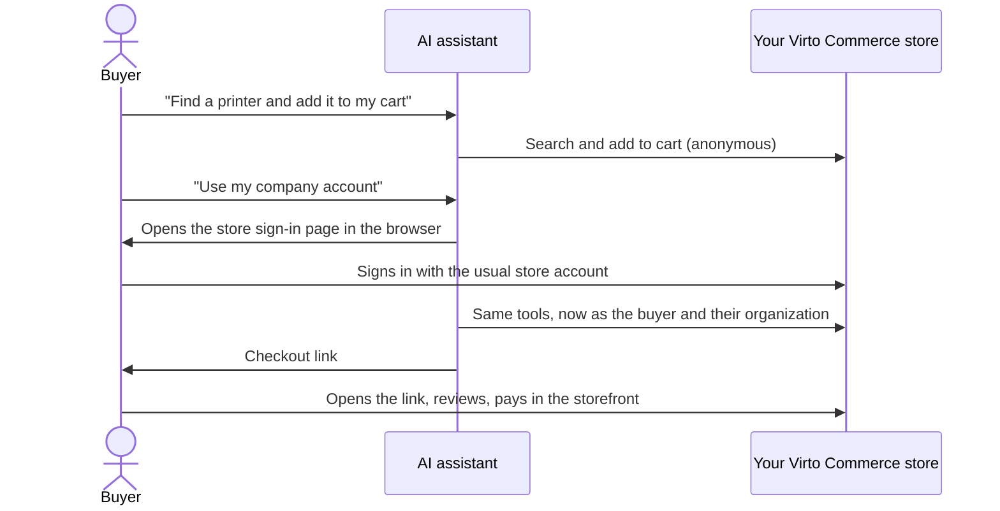
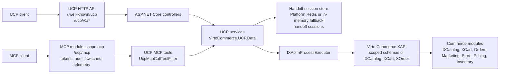

# Universal Commerce Protocol (UCP) Module

## Overview

The UCP module lets AI assistants such as Claude and ChatGPT shop a Virto Commerce store for a buyer: find products, build a cart, and hand the buyer over to the store's own checkout. It implements the Universal Commerce Protocol (UCP) on top of the platform's commerce modules, with two entry points:

* the UCP REST API: discovery at `/.well-known/ucp`, and catalog, cart, checkout handoff, geography and order tracking at `/ucp/v1/*`;
* the buyer MCP endpoint `/ucp/mcp`, the `ucp` scope of the [MCP module](https://github.com/VirtoCommerce/vc-module-mcp): the MCP module serves the endpoint, signs buyers in with the platform's OAuth, audits every call and exports the telemetry, and UCP provides the 18 shopping tools.

`VirtoCommerce.UCP` is a protocol adapter. It does not replace the Catalog, Cart, Orders, Experience API (XAPI), Store or Marketing modules: a request becomes in-process XAPI and platform service calls, without an extra HTTP hop. Public UCP endpoints have no `/api` prefix.

**Who reads what.** Buyers: [Quick start](#quick-start-connect-your-store-to-an-ai-assistant-anonymous-buyers). Merchants and business users: [How buyers shop through an AI assistant](#how-buyers-shop-through-an-ai-assistant). Administrators: [Prerequisites](#prerequisites), [Quick start, part 2: enable signed-in buyers](#quick-start-part-2-enable-signed-in-buyers) and [Manage shopping assistants in the back office](#manage-shopping-assistants-in-the-back-office). System integrators and developers: [Configuration](#configuration) and the sections after it.

## Key Features

* **Discovery**: `/.well-known/ucp` publishes the UCP manifest with the MCP endpoint and the capabilities; `get_store_capabilities` tells an assistant the stores, currency and language, endpoints, sign-in rules and error codes
* **Catalog**: product search with price filters, and product details with price and availability, through XCatalog
* **Cart**: create, list, read and replace the cart through XCart, which checks stock and order quantity limits
* **Hosted checkout**: the assistant prepares the checkout with the addresses, then gives the buyer a single-use link to the store's own checkout, where delivery and payment are chosen; the assistant never handles payment
* **Order tracking**: status, totals, items and shipments, by order id, order number or the cart id of a checkout link
* **Geography**: countries and regions from the platform, so an address given in natural language becomes a valid checkout address
* **Anonymous or signed in**: one endpoint and one set of tools; the buyer signs in with their store account only when needed, and the anonymous cart carries over
* **Buyer MCP endpoint**: `/ucp/mcp`, the `ucp` scope of the MCP module, with its audit log, tool switches and connected agents in the back office
* **Structured errors**: machine-readable error codes, the original XAPI error envelope, and a trace id for support
* **Observability**: OpenTelemetry traces, metrics and logs of every operation, inside the MCP module's span of the tool call

> [!NOTE]
> UCP is an OAuth protected resource only. The platform (OpenIddict) owns sign-in, consent, the authorization code flow with PKCE, tokens, users, organizations and the registered OAuth clients.

## Prerequisites

Install `VirtoCommerce.UCP` in the platform application; the platform installs what it depends on with it (the MCP module, the Experience API and the commerce modules). Then an administrator configures, once per store:

1. **The store.** An open store with an assigned catalog, prices, inventory and a built search index. Set its **Secure URL** (or **URL**) to the storefront host, `https://store.example.com`: UCP serves the store whose URL is the host of the request, with its default currency and language.
1. **The routes.** Route `/ucp` and `/.well-known/ucp` from the storefront host to the platform, in the environment's `infra/environments.yml` of the Virto Cloud deployment repository, and deploy the environment:

    ```yaml
    routes:
      - host: store.example.com
        root: B2B-store
        paths:
          - path: /ucp
            route: platform
          - path: /.well-known/ucp
            route: platform
    ```

1. **The people.** Grant the people who look after the assistants `mcp:audit:read` and `mcp:manage`. Buyers need no permission.
1. **The check.** `https://store.example.com/.well-known/ucp` returns the UCP manifest, which names the MCP endpoint `https://store.example.com/ucp/mcp`.

Everything else works with its default, and each further store works the same way at its own host:

| What | Default | Change it with |
| --- | --- | --- |
| The UCP endpoints | On | `MCP:Scopes:ucp:Enabled` |
| Anonymous shopping | As the store allows anonymous users | The store setting **Allow anonymous users** |
| Currency and language | The store's defaults | The store |
| The checkout page of a checkout link | `{store URL}/checkout` | The store setting `UCP.CheckoutUrlTemplate` |
| How long a checkout link stays valid | 15 minutes | The store setting `UCP.CheckoutLinkLifetimeMinutes` |
| Cart addresses | Set by the assistant | The store setting `UCP.StoreManagedAddresses` |

<details>
<summary>More about the setup</summary>

* The storefront (`vc-frontend`) opens the checkout links on its checkout page.
* `root` is the Store ID, not the store's display name.
* `/ucp` covers the MCP endpoint `/ucp/mcp` and the REST API `/ucp/v1/*`; `/.well-known/ucp` is outside that prefix and needs its own route.
* Outside Virto Cloud, route the same paths from the storefront host to the platform, and keep the original host visible to the platform (forwarded headers).
* claude.ai and ChatGPT connect from their own cloud, so the storefront host must be reachable from the internet over HTTPS; a host behind a VPN works only if it allows their published IP ranges.
* A remote URL does not go in `claude_desktop_config.json`, which is for MCP servers that run on the computer.
* To check the store's values, ask the assistant: *Use the Virto Commerce connector. First call get_store_capabilities, then search for "printer".* The result shows `default_store_id` with the store's currency, language and storefront URL, and **Configuration → AI agents (MCP) → Agent audit log** shows both calls in the `ucp` scope.

</details>

## Quick start: connect your store to an AI assistant (anonymous buyers)

The assistant's address is your storefront host followed by `/ucp/mcp`:

```text
https://store.example.com/ucp/mcp
```

Buyers shop anonymously with this URL alone: no account, client id or sign-in. Replace `store.example.com` with your storefront host. An administrator configures the store once first: [Prerequisites](#prerequisites). To let buyers sign in too, continue with [part 2](#quick-start-part-2-enable-signed-in-buyers).

Then pick your assistant:

**Claude Desktop and claude.ai**

1. **Settings → Connectors → Add custom connector.**
1. Name: `Virto Commerce`. URL: the address above. **Add**.
1. Enable the connector in a conversation.

In a Team or Enterprise organization, an owner adds the connector for everyone first. See Anthropic's [guide to custom connectors](https://support.claude.com/en/articles/11175166-get-started-with-custom-connectors-using-remote-mcp).

**ChatGPT**

In developer mode (ChatGPT Business, Enterprise or Edu), **Settings → Apps → Create** an app with the address above. See OpenAI's [developer mode guide](https://help.openai.com/en/articles/12584461-developer-mode-apps-and-full-mcp-connectors-in-chatgpt-beta).

**Claude Code**

```bash
claude mcp add --transport http virto-store https://store.example.com/ucp/mcp
```

**VS Code**

Add the server to `.vscode/mcp.json`:

```json
{
  "servers": {
    "virto-store": { "type": "http", "url": "https://store.example.com/ucp/mcp" }
  }
}
```

**Try it.** Ask for example:

* *Find a laser printer under $300 at Virto Commerce.*
* *Add two of them to my cart and check out, shipping to 350 Fifth Avenue, New York.* The assistant gives a link to the store's own checkout, where the buyer chooses delivery and pays.
* *Sign me in and show my orders.* This needs [signed-in buyers](#quick-start-part-2-enable-signed-in-buyers).

Menu names in the assistants change from release to release; if a step does not match, check the assistant's own documentation.

### Troubleshooting

| Symptom | Check |
| --- | --- |
| The assistant cannot connect | The environment routes `/ucp` to the platform, the storefront host is public, and the updated environment was deployed. |
| The connector lists no tools | `VirtoCommerce.MCP` is installed, and the `ucp` scope is not switched off (`MCP:Scopes:ucp:Enabled`, or the scope switch on **Agent tools**). |
| `missing_store_id` | The store's Secure URL or URL has the host the assistant connects to; for requests to another host, set `VirtoCommerce__Stores__DefaultStore` to the Store ID. |
| Search returns no products | The store is open, its catalog is assigned, prices and inventory exist, and the search index is built. |
| The checkout link opens the wrong host | Set the store's Secure URL; for a checkout page that is not at `/checkout`, set the store setting `UCP.CheckoutUrlTemplate`. |
| A Team or Enterprise user cannot add the connector | An organization owner adds the custom connector first. |

## Quick start, part 2: enable signed-in buyers

The [quick start](#quick-start-connect-your-store-to-an-ai-assistant-anonymous-buyers) above sets up anonymous shopping. The steps below, for Virto Cloud, let buyers sign in, so the assistant can shop with their prices, organization, carts and orders. The examples use `B2B-store` as the Store ID and `https://store.example.com` as the public Storefront host.

UCP does not sign buyers in itself. Virto Commerce Platform (OpenIddict) handles sign-in, consent and tokens; the Storefront hosts the sign-in page. The Storefront host therefore acts as both the MCP endpoint and the OAuth authorization server.

### 1. Check the prerequisites

The [Prerequisites](#prerequisites) above, and a storefront (`vc-frontend`) release with the `/oauth/authorize` sign-in page and the authenticated checkout restore ([vc-frontend#2467](https://github.com/VirtoCommerce/vc-frontend/pull/2467)).

### 2. Update the Platform configuration

Add these values under `platform.config` in `infra/environments.yml`:

```yaml
platform:
  config:
    Authorization__Resources__0: "https://store.example.com/ucp/mcp"
    Authorization__OAuthLoginPath: /oauth/authorize
```

- `Authorization__Resources__0` allows Platform to issue tokens for the UCP MCP endpoint. If `Authorization:Resources` already lists other addresses, add this one with the next index instead of replacing them.
- `Authorization__OAuthLoginPath` sends buyers to the Storefront sign-in page instead of the Platform back-office sign-in page.

The resource, the OAuth client permission in step 5 and the store's Secure URL must use the **same host**: UCP advertises the store's URL for discovery, MCP and OAuth. Mixing the platform host and the storefront host produces tokens that UCP rejects. For several stores, add one resource and one `rsrc:` permission per store host.

### 3. Provide Redis when the Platform has more than one replica

Checkout links and their single-use protection are shared between Platform replicas through Redis. Without Redis, each replica keeps its own links, so a link opened on another replica is reported as expired or already used. In QA with two replicas and no Redis, about half of anonymous and about three quarters of signed-in checkout links failed on the first attempt.

Platform reads Redis from `ConnectionStrings__RedisConnectionString`. In Virto Cloud this connection string is a secret, not a plain `platform.config` value. Ask Virto Cloud support to provision Redis for the environment. *To verify: the exact provisioning steps for Virto Cloud environments.*

A single-replica environment works without Redis, but open checkout links are lost when the Platform restarts.

### 4. Route the OAuth paths to the Platform

The quick start routes `/ucp` and `/.well-known/ucp`. Signed-in buyers also need the OAuth endpoints on the Storefront host, because the Storefront sign-in page calls them on its own host and AI assistants discover them from there:

```yaml
routes:
  - host: store.example.com
    root: B2B-store
    paths:
      - path: /ucp
        route: platform
      - path: /.well-known/ucp
        route: platform
      - path: /.well-known/oauth-protected-resource
        route: platform
      - path: /.well-known/openid-configuration
        route: platform
      - path: /connect
        route: platform
```

- `/.well-known/oauth-protected-resource` tells the assistant which authorization server protects `/ucp/mcp`.
- `/.well-known/openid-configuration` publishes the authorization server metadata.
- `/connect` covers sign-in (`/connect/authorize`), tokens (`/connect/token`), sessions (`/connect/session`) and sign-out.

Keep `/oauth/authorize` routed to the Storefront; it is the sign-in page. *To verify: whether an AI client in use also requests `/.well-known/oauth-authorization-server`; if it does, route it to the Platform too.*

Deploy the updated environment.

### 5. Register an OAuth client for the AI assistant

Each AI assistant signs buyers in through a registered OAuth client:

| Field | Value |
| --- | --- |
| Client type | `public` (no client secret) |
| Consent type | `explicit` (the buyer sees which assistant they let shop as them, once per buyer and assistant) |
| Redirect URI | The callback URL of the AI assistant. For Claude custom connectors this is `https://claude.ai/api/mcp/auth_callback` (*to verify against the current Anthropic documentation*). |
| Permissions | `rsrc:https://store.example.com/ucp/mcp` |

The **Security > OAuth applications** screen has no field for `rsrc:` permissions yet ([VCST-6641](https://virtocommerce.atlassian.net/browse/VCST-6641) adds it, and this step then moves to the screen). Until then, create the client through the Platform API, for example from the browser console while signed in to the Platform Manager as an administrator:

```javascript
(async () => {
  const api = angular.element(document.body).injector().get("platformWebApp.oauthapps");
  const app = await api.new().$promise;
  app.displayName = "Claude";
  app.clientType = "public";
  app.clientSecret = null;
  app.consentType = "explicit";
  app.redirectUris = ["https://claude.ai/api/mcp/auth_callback"];
  app.permissions = ["rsrc:https://store.example.com/ucp/mcp"];
  const saved = await api.save({}, app).$promise;
  console.log("CLIENT_ID:", saved.clientId, "PERMISSIONS:", saved.permissions);
})().catch(console.error);
```

Check that the printed permissions contain `rsrc:https://store.example.com/ucp/mcp`, and give the printed `CLIENT_ID` to whoever sets up the assistant. Later edits to the client on the OAuth applications screen keep the `rsrc:` permission.

### 6. Connect the AI assistant

**Claude.** Add the custom connector as in the [quick start](#quick-start-connect-your-store-to-an-ai-assistant-anonymous-buyers), with the remote MCP server URL `https://store.example.com/ucp/mcp`. Under **Advanced settings**, enter the OAuth client ID from step 5.

**ChatGPT.** Full MCP connectors require a ChatGPT Business or Enterprise/Edu workspace with developer mode enabled. Create one app under **Settings > Apps > Create** with the URL `https://store.example.com/ucp/mcp` and OAuth authentication. See the [OpenAI developer mode guide](https://help.openai.com/en/articles/12584461-developer-mode-apps-and-full-mcp-connectors-in-chatgpt-beta).

Use one connector for both anonymous and signed-in shopping. Do not add a second connector for signed-in buyers.

### 7. Verify the setup

1. Open `https://store.example.com/.well-known/ucp`, and the same path on the Platform host. Both must report the same MCP endpoint, `https://store.example.com/ucp/mcp`.
2. Open `https://store.example.com/.well-known/oauth-protected-resource/ucp/mcp`. `resource` must be `https://store.example.com/ucp/mcp`, and `authorization_servers` must be `["https://store.example.com/"]`.
3. In a new conversation, ask the assistant to use your account. It must call `link_buyer_identity`, open the Storefront sign-in page, and then report `linked: true` with your buyer and organization.
4. Ask it to add a product to your cart and prepare checkout. Open the checkout link: the Storefront must show your cart, prices and organization.

### 8. Keep checkout links out of analytics

The checkout link carries its one-time token in the `ucp_session` query parameter. Until [VCST-6053](https://virtocommerce.atlassian.net/browse/VCST-6053) is fixed, the token can be sent to Google Analytics as part of the page URL and stored in Application Insights telemetry. Remove `ucp_session` from page URLs in your analytics configuration.

### Troubleshooting signed-in buyers

| Symptom | Check |
| --- | --- |
| Token request fails with `invalid_target` | `Authorization__Resources__0` contains `https://store.example.com/ucp/mcp`, and the OAuth client has the permission `rsrc:https://store.example.com/ucp/mcp`. |
| `link_buyer_identity` returns `401 invalid_token` after sign-in | The MCP URL, the store's Secure URL, the resource and the OAuth client permission all use the Storefront host. |
| Sign-in opens the Platform back-office page | `Authorization__OAuthLoginPath` is set to `/oauth/authorize`, and the Storefront includes the sign-in page. |
| Sign-in page cannot complete, or the assistant never receives a token | `/connect` and `/.well-known/openid-configuration` are routed to `platform` on the Storefront host. |
| Checkout links are reported as expired or already used on the first try | The Platform has more than one replica and no Redis. See step 3. |
| `403 buyer_context_mismatch` | The link was opened by a different buyer, or a client sent a legacy `X-Buyer-*` header. |
| The assistant keeps using the previous account | Signing out of the Storefront does not change the assistant's token. Disconnect and reconnect the connector. |

## How buyers shop through an AI assistant

This section is for merchants and business users. It describes what a buyer experiences when an AI assistant, such as Claude or ChatGPT, shops your store through UCP. Setup steps for IT are in [Prerequisites](#prerequisites) and [Quick start, part 2](#quick-start-part-2-enable-signed-in-buyers).



**Anonymous by default.** A buyer can search products and build a cart without signing in. The assistant does not ask for an account until the buyer needs one.

**Signing in.** When the buyer asks the assistant to use their account, order for their company, or see their orders, the assistant asks them to sign in. Your store's own sign-in page opens in the browser. The buyer signs in with their usual store account, and the assistant continues from where it stopped. The assistant never sees the buyer's password.

**What signing in unlocks.** After signing in, the assistant works with the buyer's own data:

- the buyer's prices, including organization contract pricing;
- the products available to the buyer's organization;
- the buyer's saved carts and orders.

**The anonymous cart carries over.** Items the buyer added before signing in are merged into their account cart.

**Checkout stays in your storefront.** The assistant prepares the cart and gives the buyer a checkout link. The buyer opens it, reviews the order, chooses delivery and payment, and places the order in your normal storefront. Approval rules, purchase orders and invoice terms apply there exactly as they do today. When the assistant says the checkout "requires review", it means "continue in the store", not "this order needs approval".

**The checkout link is short-lived and personal.**

- It works once and expires after 15 minutes by default.
- Only the buyer it was created for can use it; another signed-in buyer is refused.
- If the link expires, ask the assistant for a new one. The cart itself is kept.

**Signing out and switching accounts.**

- Asking the assistant to log out ends its session with your store.
- Signing out of the storefront in the browser does not sign the assistant out.
- To shop as a different account, the buyer must disconnect and reconnect the store connector in the assistant.

**What the assistant cannot do.** It cannot take payment, place orders, or see another buyer's carts, orders or prices.

### Known limitations

- Logging out does not cancel checkout links issued before logout, and an issued link cannot be revoked early. It stops working after it is used or expires.
- For a signed-in buyer, creating a cart adds items to the buyer's existing default cart instead of starting a new, empty cart.
- A shipping address given to the assistant can update the matching address saved on the buyer's account.

## Manage shopping assistants in the back office

Shopping assistants use the MCP module's back-office screens, under **Configuration → AI agents (MCP)**, in the `ucp` scope:

* **Agent audit log**: every tool call an assistant made, with the signed-in buyer if there is one, the assistant's OAuth client, the outcome and the duration. Buyer names, emails, phone numbers and addresses are masked. When a buyer reports a problem, search for the trace id the assistant shows with an error.
* **Agent tools**: switch a shopping tool off without a deployment, for example `checkout_and_handoff`, or the whole `ucp` scope.
* **Connected agents**: the assistants buyers signed in to. **Disconnect** ends a buyer's sign-in at once; the buyer signs in again to continue.

The screens need the MCP module's permissions `mcp:audit:read` and `mcp:manage`; see [Work with agents in the back office](https://github.com/VirtoCommerce/vc-module-mcp#work-with-agents-in-the-back-office).

## Configuration

> [!NOTE]
> This section and the ones after it are for system integrators and developers.

### Where each value comes from

UCP needs almost no configuration of its own: it takes the store of each request from the request's host and reads the rest from that store. One platform serves several stores this way, each at its own storefront host.

| Value | Source | Who sets it |
| --- | --- | --- |
| The store of a request | The request's host, resolved as XAPI resolves a storefront's domain (`IStoreDomainResolverService`): `VirtoCommerce:Stores:Domains`, then the store whose `Url` has that host; then `VirtoCommerce:Stores:DefaultStore`; then the only open store. `Origin` and `Referer` are not used. An operation that names another store with `store_id` runs with that store's values | Store administrator (the store's URL); IT for domain mappings |
| Currency and language | The store's default currency and language | Store administrator |
| Storefront, checkout and cart links, public origin | The store's `SecureUrl`, then `Url` | Store administrator |
| Anonymous shopping | The store's **Allow anonymous users**; `UCP:AnonymousCatalog = false` turns it off for assistants only | Store administrator |
| Addresses the storefront assigns itself | Store setting `UCP.StoreManagedAddresses` | Store administrator |
| Lifetime of a checkout link | Store setting `UCP.CheckoutLinkLifetimeMinutes` (15) | Store administrator |
| Checkout page of a storefront not at `/checkout` | Store setting `UCP.CheckoutUrlTemplate`, with `{token}` | Store administrator |
| UCP on or off | `MCP:Scopes:ucp:Enabled` ([Switching UCP on and off](#switching-ucp-on-and-off)) | IT |
| A fixed public origin | `MCP:Scopes:ucp:PublicOrigin`, only where the platform cannot see the public host | IT |
| What operation input reaches telemetry | `UCP:Observability:InputCaptureMode` | IT |

The store settings are in the back office, in each store's settings under **UCP**.

### Configured by IT

Only infrastructure, secrets and privacy choices stay in configuration:

| Key | Why |
| --- | --- |
| `Authorization:Resources` | Allows tokens for each public MCP URL, one per store host: `https://store.example.com/ucp/mcp` |
| `Authorization:OAuthLoginPath` | Sends buyers to the storefront sign-in page |
| `ConnectionStrings:RedisConnectionString` | Shares checkout links between replicas |
| `MCP:Scopes:ucp:Enabled`, `MCP:Scopes:ucp:Hosts`, `MCP:Scopes:ucp:PublicOrigin` | The buyer endpoint, in the MCP module's configuration |
| `VirtoCommerce:Stores:DefaultStore`, `VirtoCommerce:Stores:Domains` | The store of a request to a host that is not a store's own, shared with the Experience API |
| `UCP:Observability:InputCaptureMode`, `UCP:AnonymousCatalog` | Privacy and the assistants-only switch for anonymous shopping |
| Forwarded headers, proxy routes, OpenTelemetry, Serilog levels | The host in front of the platform and the telemetry |

```json
{
  "UCP": {
    "AnonymousCatalog": true,
    "Observability": { "InputCaptureMode": "ErrorsOnly" }
  }
}
```

| Key | Type | Default | Description |
| --- | --- | --- | --- |
| `UCP:AnonymousCatalog` | Boolean | `true` | `false` makes assistants sign the buyer in from the first request, even where the store allows anonymous users. `get_store_capabilities` reports the result as `auth.anonymous_catalog` (see [Buyer identity](#buyer-identity)). |
| `UCP:Observability:InputCaptureMode` | Enum | `ErrorsOnly` | The bounded, allowlisted operation input in logs and span attributes: `None`, `ErrorsOnly` or `Always`. Trace correlation, safe context attributes and counters stay on in every mode. |

### Obsolete keys

These keys still work, as the value for a request that no store is resolved for, and the platform logs a warning at startup for each one that is set:

| Key | Instead |
| --- | --- |
| `UCP:DefaultStoreId` | The store of the request's host; `VirtoCommerce:Stores:DefaultStore` for requests to other hosts |
| `UCP:DefaultCurrency`, `UCP:DefaultCultureName` | The store's default currency and language |
| `UCP:StorefrontOrigin`, `UCP:UcpBaseUrl` | The store's URL |
| `UCP:PublicOrigin` | `MCP:Scopes:ucp:PublicOrigin`, or nothing: the store's URL is used |
| `UCP:HandoffUrlTemplate`, `UCP:HandoffTokenTtlMinutes`, `UCP:StoreManagedAddresses` | The store settings `UCP.CheckoutUrlTemplate`, `UCP.CheckoutLinkLifetimeMinutes` and `UCP.StoreManagedAddresses` |

`UCP:DefaultStoreId` no longer overrides the request's host: a request to a store's host is for that store.

### Switching UCP on and off

UCP has no setting of its own: it is switched with the MCP module's configuration of the `ucp` scope.

```json
"MCP": {
  "Scopes": {
    "ucp": { "Enabled": false }
  }
}
```

With `MCP:Scopes:ucp:Enabled` set to `false`, the MCP module serves no `/ucp/mcp`, and UCP answers `404` without running the request on these URL prefixes (segment-aware, case-insensitive; `/ucpx` is not matched):

- `/ucp` (the REST API `/ucp/v1/*` and the MCP endpoint `/ucp/mcp`, for every HTTP method)
- `/.well-known/ucp`
- `/.well-known/oauth-protected-resource/ucp`

The scope is on by default. The value is read at startup, so a change applies after a restart of every instance; as an environment variable, `MCP__Scopes__ucp__Enabled=false`. To stop a single shopping tool without a restart, switch it off on the MCP module's **Agent tools** screen instead.

### Permissions

The module registers no permissions of its own. What a buyer may do is decided elsewhere:

| What | Decided by |
| --- | --- |
| Anonymous shopping | The store setting **Allow anonymous users**; when it is off, `/ucp/mcp` asks for a sign-in from the first request |
| Signed-in buyers | The platform's OAuth sign-in (`link_buyer_identity`); the buyer's carts, orders and prices come from the Experience API, which checks that they belong to the buyer |
| The back office of the assistants | The MCP module's `mcp:audit:read` and `mcp:manage` |
| UCP's store settings | The Store module's permissions to edit a store |

### Multiple instances and the public origin

Handoff sessions are stored through the UCP `IUcpHandoffSessionStore`. When `ConnectionStrings:RedisConnectionString` is configured, UCP uses the Platform Redis connection (`IConnectionMultiplexer`) and stores each session as a Redis string under `vc:ucp:handoff:<sha256>` with a TTL of `UCP:HandoffTokenTtlMinutes`. Without Redis, UCP uses a process-local memory store. UCP does not open its own Redis connection and does not register or replace `IDistributedCache`. A host can supply its own `IUcpHandoffSessionStore`; UCP registers its store only when none is registered.

Restore is serialized per session through the Platform `IDistributedLock` (`VirtoCommerce.Platform.Core.DistributedLock`), which also uses Redis when `ConnectionStrings:RedisConnectionString` is configured and an in-process lock otherwise. The store and the lock therefore always use the same backend. A restore that cannot take the lock within 10 seconds returns `409 handoff_in_progress`.

To restore handoff sessions across replicas, configure the same `ConnectionStrings:RedisConnectionString` (and Redis database) on every replica. With the memory store, another process cannot restore the session, and a restart loses it.

UCP's public origin is the URL of the request's store (`SecureUrl`, then `Url`; see [Where each value comes from](#where-each-value-comes-from)), and the request's own origin when the store has none. Set `MCP:Scopes:ucp:PublicOrigin` only where the platform cannot see the public host, for example behind a proxy that does not forward it.

Discovery, protected-resource metadata, bearer challenges and MCP audience validation use this same origin even when discovery is read through the backend host. Add `<resolved-origin>/ucp/mcp` to Platform `Authorization:Resources` and grant `rsrc:<resolved-origin>/ucp/mcp` to the registered OAuth client. The client must connect to the advertised public MCP endpoint and use the authorization server advertised there. Resource registration and OAuth client permissions remain enforced by Platform/OpenIddict.

For rollout from process-local sessions, drain existing handoffs on the old deployment before switching traffic, or wait at least `HandoffTokenTtlMinutes` after stopping issuance. A Redis-backed release cannot recover sessions stored only in an old process. Do not mix releases using raw-token cache keys with releases using hashed keys; use a drained cutover. Current releases keep the hashed key format and use one shared lock for each session. If a concurrent restore holds that lock, UCP returns `409` with `handoff_in_progress`; the session is not consumed and the client may retry. Do not add retry-on-400 behavior: a consumed, expired or forged token must remain rejected.

`requires_escalation` means the buyer must continue in hosted checkout, not that approval is required. The response includes `hosted_checkout_required` with `requires_buyer_review`. Merchant approval rules and PO/invoice terms are applied by the existing storefront and commerce modules; UCP does not infer them from the cart amount.

Handoff store dependency spans (`VC handoff-session-store SetHandoffSession`, `GetHandoffSession`, `RemoveHandoffSession`) include `vc.ucp.handoff.key_hash`, the SHA-256 session-key suffix, on set/get/remove. This allows cross-node correlation without recording the bearer capability. The hash is a trace dimension, never a metric label. Correlate it with `vc.dependency.outcome` and the instance identity to distinguish misses, expiry, corruption and successful consumption.

### Observability

The module emits exporter-neutral `VirtoCommerce.UCP` activities and metrics through the standard .NET diagnostics APIs:

```text
MCP/REST request
└─ UCP <operation>
   └─ XAPI <schema> <GraphQL operation>
      └─ existing SQL, Elastic, HTTP, cache, and other dependency spans
```

Each actual in-process XAPI execution gets its own span. UCP does not create or modify an OpenTelemetry provider and does not configure an OTLP exporter, endpoint, sampler, service resource, Serilog sink, or minimum logging level; those remain controlled by Platform and the Virto Commerce OpenTelemetry module.

Each UCP operation writes one structured terminal log: `Information` for success/rejection/cancellation and `Error` for failures. The log contains outcome, duration, XAPI call/failed/canceled/GraphQL-error counts, factual XAPI mutation attempt/failed counts, and trace/span ids. It does not infer transaction commit state or retry safety.

The terminal event has stable `EventId=2000`, `EventName=ucp.operation.completed`, and schema version `1`. When enabled by `InputCaptureMode`, its `InputJson` is an operation-specific allowlist rather than a serialized request body. It retains values needed to reproduce a call (for example search text, requested/effective store, currency, culture, product/cart/order identifiers, line item identifiers and quantities) and reports truncation explicitly. UCP response bodies and output snapshots are not copied into telemetry; successful-result semantics are verified by reproducing the captured input under a debugger when `Always` is explicitly enabled.

The following values are never copied into these snapshots: authorization or API keys, raw handoff/session tokens, address text and postal codes, buyer identities or contact data, organization identities, cart names, notes, payment data, raw coupon values, GraphQL documents, complete variables, and complete results. Tokens/cursors use a bounded fingerprint where correlation is useful; private identity, address, and buyer data use field-presence flags plus safe country/region identifiers.

Direct dependency spans record `vc.dependency.outcome`. Successful dependencies use `success`; handoff cache reads use the more specific `hit`, `miss`, `expired`, or `corrupt` outcomes without changing the client-facing invalid-session contract.

`UCP:Observability:InputCaptureMode` supports:

- `ErrorsOnly` (default): write the allowlisted input only for `error`, `rejected`, or `degraded` outcomes;
- `Always`: write it for successful and failed operations;
- `None`: omit `InputJson` and raw diagnostic query/filter values while retaining bounded operational context, derived length/hash tags, and counters.

Production Platform configuration must allow `Information` for the `VirtoCommerce.UCP` category, otherwise successful/rejected/canceled terminal events are filtered before any exporter sees them:

```json
{
  "Serilog": {
    "MinimumLevel": {
      "Override": {
        "VirtoCommerce.UCP": "Information"
      }
    }
  }
}
```

Unhandled XAPI resolver exceptions are captured through GraphQL.NET's `UnhandledExceptionDelegate`. The original exception is attached to the active XAPI span as the standard OpenTelemetry `exception` event (`exception.type`, `exception.message`, `exception.stacktrace`) and emitted as one correlated structured error log (`EventId=2001`; unexpected failures of an MCP call and of a REST call are logged as `2002` and `2003`) with the same trace/span ids and a safe failing-call input summary. Expected GraphQL errors without a CLR exception contain bounded codes, paths, and messages but no invented stack trace. UCP never writes the complete GraphQL response envelope to its own logs.

UCP deliberately does not register its sources or meter with the process-wide OpenTelemetry provider. When using Virto Commerce OpenTelemetry `3.1002.0` or later, opt them in explicitly:

```json
{
  "OpenTelemetry": {
    "Enabled": true,
    "Endpoint": "http://localhost:4317",
    "Sources": [
      "VirtoCommerce.UCP",
      "VirtoCommerce.MCP",
      "Experimental.ModelContextProtocol"
    ],
    "Meters": [
      "VirtoCommerce.UCP",
      "VirtoCommerce.MCP"
    ]
  }
}
```

Set the process-wide `OTEL_SERVICE_NAME` as usual. `Sources` and `Meters` must be arrays, and every value must match the corresponding source or meter name exactly. Without this opt-in, UCP still works, but its custom spans or metrics are not exported by that provider. In Azure Monitor, UCP/XAPI `ActivityKind.Internal` spans map to dependencies and their attributes become custom dimensions; the trace id correlates them with ASP.NET requests and structured logs.

`VirtoCommerce.MCP` and `Experimental.ModelContextProtocol` are the MCP module's and the MCP SDK's: the `MCP tool <tool>` span wraps UCP's `UCP <operation>` span, so one call of a shopping assistant is one trace ([Observability](https://github.com/VirtoCommerce/vc-module-mcp#observability)).

To send traces, metrics and logs to Application Insights, set `OpenTelemetry:AzureMonitor:ConnectionString` in the OpenTelemetry module.

## Architecture



### Request flow

1. A client calls a canonical UCP endpoint, or an MCP client calls a tool on `/ucp/mcp`.
2. The controller accepts the HTTP request and delegates work to a UCP service. For an MCP call, the MCP module checks the token, the tool switch and the arguments, then runs `UcpMcpCallToolFilter` (store checks, UCP errors and telemetry) and the tool, which calls the same UCP service.
3. The service normalizes UCP request context and derives any authenticated buyer identity from the validated Platform principal.
4. Catalog operations are translated to XCatalog GraphQL queries.
5. Cart operations are translated to XCart GraphQL queries and mutations.
6. `IXApiInProcessExecutor` runs GraphQL inside the current platform process.
7. The service maps XCatalog, XCart, Orders, Store, and platform dictionary data back to UCP response models.

Commerce tools do not expose an authentication mode. A request without a Platform user bearer token uses the public/anonymous flow; a request with a valid token uses the linked buyer and organization from the Platform `ClaimsPrincipal`.

### Buyer identity

The MCP module signs buyers in: it publishes the protected-resource metadata at `/.well-known/oauth-protected-resource/ucp/mcp`, answers a call that needs a buyer with the HTTP 401 challenge, and checks the token and its revocation on every request ([Authentication](https://github.com/VirtoCommerce/vc-module-mcp#authentication)). The platform issues the tokens; UCP issues none and does not register OAuth clients. UCP decides who the buyer is and what a sign-in changes:

When `UCP:AnonymousCatalog` is `false`, or the default store does not allow anonymous users, the MCP endpoint asks for a sign-in from the first request: an anonymous request, `initialize` and `tools/list` included, gets the HTTP 401 challenge, so the client starts OAuth when it connects. `logout_buyer` is never challenged. UCP answers these requests itself, in the platform pipeline before authentication, with the scope's challenge.

* An assistant calls `link_buyer_identity` when the buyer asks to use their account. Without a token, the call gets the challenge and the client signs the buyer in; with a valid token, it returns the buyer and organization without another sign-in. The commerce tools are then called unchanged.
* To keep an anonymous cart, the assistant calls `update_cart` with the saved anonymous `buyer_id`, the `cart_id` and the complete line state. UCP checks the anonymous owner and calls XCart `mergeCart`.
* Signing in or out of the storefront does not change the assistant's account. To switch buyers, reconnect the assistant, then call `link_buyer_identity` and check the identity it returns.
* `logout_buyer` revokes the current authorization and its tokens, which also signs out other connections that share it; other OAuth applications and storefront cookies are not affected. Without a token, it succeeds and does nothing. Afterwards the assistant discards the buyer, organization, cart and checkout ids, and does not sign in again until the buyer asks.
* Anonymous carts use an opaque `ucp-anonymous-*` buyer id. `X-Buyer-User-Id` and `X-Buyer-Organization-Id` headers are refused.

### MCP endpoint

`/ucp/mcp` is the `ucp` scope of the [MCP module](https://github.com/VirtoCommerce/vc-module-mcp), registered in `Module.Initialize`:

```csharp
serviceCollection.AddMcpScope(new McpScope
{
    Name = ModuleConstants.McpScopeName, // "ucp", served at /ucp/mcp
    Title = "Virto Commerce UCP",
    Version = ModuleConstants.UcpVersion,
    Instructions = ModuleConstants.McpInstructions,
    RequireAuthenticatedUser = false, // anonymous shopping; link_buyer_identity asks for a sign-in
}, scope => scope
    .WithChallengeWriter<UcpMcpChallengeWriter>()
    .WithPublicOriginResolver<UcpMcpPublicOriginResolver>()
    .WithCallToolFilter<UcpMcpCallToolFilter>());
serviceCollection.AddMcpToolsFromAssembly(typeof(UcpMcpCommerceTools).Assembly, UcpMcpSerialization.Options);
```

The writer, the resolver and the filter are declared with the scope, so they serve `/ucp/mcp` only and other scopes keep the MCP module's ones; none of them checks which scope it serves.

The MCP module serves the endpoint: the transport, sign-in and token checks, tool switches, argument validation, the audit log and the tool call span ([Scopes](https://github.com/VirtoCommerce/vc-module-mcp#scopes), [Tool call flow](https://github.com/VirtoCommerce/vc-module-mcp#tool-call-flow)). UCP adds:

* the tools in the table below, which call the same UCP services as the REST API;
* `UcpMcpCallToolFilter`: for the 16 commerce tools, the `store_id` checks, UCP and XAPI error envelopes, the `UCP {operation}` span, and the trace id in `_meta.trace_id` and in the text of the result;
* `UcpMcpChallengeWriter`: UCP's `identity_required` body of the HTTP 401 and 403 responses;
* `UcpMcpPublicOriginResolver`: the public origin of the scope, from `MCP:Scopes:ucp:PublicOrigin` or the request's store (see [Multiple instances and the public origin](#multiple-instances-and-the-public-origin)); the MCP module's `MCP:PublicOrigin` and `MCP:Scopes:ucp:PublicOrigin` do not apply to this scope.

To serve the scope also at `https://store.example.com/mcp`, set `MCP:Scopes:ucp:Hosts` and add that address to `Authorization:Resources` and to the OAuth client's `rsrc:` permissions: it is a separate OAuth resource. Discovery keeps naming `/ucp/mcp`.

| Area | Tools |
| --- | --- |
| Discovery | `get_store_capabilities` |
| Catalog | `search_products`, `get_product` |
| Cart | `create_cart`, `list_carts`, `get_cart`, `update_cart` |
| Checkout | `create_checkout`, `update_checkout`, `get_payment_handlers`, `handoff_checkout`, `checkout_and_handoff` |
| Orders | `track_order` |
| Geography | `list_countries`, `resolve_country`, `list_regions` |
| Buyer identity | `link_buyer_identity`, `logout_buyer` |

The tools take no storefront URL: the endpoint is the store, and the tools run UCP's services in the platform process.

## Web API

### Discovery

```http
GET /.well-known/ucp
```

Returns the UCP manifest: the version, the MCP service endpoint under `services["com.virtocommerce.ucp"]`, and the capability versions. The full store profile, with the default store, endpoints and `endpoints.operations`, headers, the auth shape, agent guidance and the error codes, is the result of the MCP tool `get_store_capabilities`.

### Catalog search

```http
POST /ucp/v1/catalog/search
```

Example request:

```json
{
  "query": "iphone",
  "context": {
    "store_id": "store-acme",
    "currency": "USD",
    "language": "en-US"
  },
  "filters": {
    "price": {
      "min": 50000,
      "max": 100000
    }
  },
  "pagination": {
    "limit": 10
  }
}
```

UCP prices and price filters use minor units. For example, `$700.00` is represented as `70000`.

### Product detail

```http
GET /ucp/v1/catalog/products/{id}?store_id=store-acme&currency=USD&culture_name=en-US
```

The product response includes id, code, name, slug, image URL, brand, product type, price, list price, availability, attributes, and variations.

If a product is not found, the endpoint returns the structured error `product_not_found`.

### Cart assembly

```http
POST /ucp/v1/carts
GET /ucp/v1/carts?store_id=store-acme&currency=USD&culture_name=en-US&buyer_id=ucp-anonymous-0123456789abcdef0123456789abcdef
GET /ucp/v1/carts/{cartId}?store_id=store-acme&currency=USD&culture_name=en-US
PUT /ucp/v1/carts/{cartId}
PATCH /ucp/v1/carts/{cartId}
```

`PUT` and `PATCH` both run `update_cart`. The cart list also takes `cart_type`, `organization_id`, `cursor`, `limit` and `sort`. An anonymous `buyer_id` is the `ucp-anonymous-*` id UCP issued; with a token, it must be the token's user, or the call gets `403 buyer_context_mismatch`.

`create_cart` creates a cart through XCart `addItem`, then applies coupons through `addCoupon`.

`list_carts` is a Virto extension over the XCart `carts` query. Anonymous continuation requires the server-issued `buyer_id`; authenticated mode derives the buyer and organization from the Platform token. It never returns a global cart list.

`update_cart` follows UCP replacement semantics: the request describes the desired final cart state, and the adapter computes the required XCart mutations:

- `addItem`
- `changeCartItemQuantity`
- `removeCartItem`
- `addCoupon`
- `removeCoupon`

To remove a line item, omit it from `line_items` or pass an existing `line_items[].id` with `quantity: 0`.

### Geography

```http
GET /ucp/v1/geography/countries?query=United%20States&limit=10
GET /ucp/v1/geography/countries/resolve?query=KZ
GET /ucp/v1/geography/countries/{countryId}/regions
```

Geography endpoints are thin adapters over the platform `ICountriesService`.

- `list_countries` returns platform countries and supports simple search by `id` or `name`.
- `resolve_country` accepts ISO2, ISO3, or platform country name and returns the platform country id, for example `KZ -> KAZ`.
- `list_regions` returns platform regions or provinces for a resolved country id.
- `city` is not resolved through a dictionary and remains a free-text checkout address field.

MCP clients should use these endpoints before checkout when country or region data comes from natural language input. This avoids guessing and preserves the existing storefront and XCart address contracts.

### Checkout handoff

```http
POST /ucp/v1/checkouts
PATCH /ucp/v1/checkouts/{checkoutId}
GET /ucp/v1/checkouts/{checkoutId}/payment-handlers
POST /ucp/v1/checkouts/{checkoutId}/handoff
POST /ucp/v1/internal/handoff/restore
```

The current checkout flow is hosted-only:

- `create_checkout` creates a checkout snapshot from the cart.
- If the request contains `shipping_address` or `billing_address`, the module applies them to XCart before creating the snapshot.
- `update_checkout` updates address hints before payment and applies addresses to XCart.
- `checkout_and_handoff` creates the checkout snapshot and immediately returns the hosted checkout `continue_url`; MCP clients should prefer it when the buyer is ready to pay or continue to storefront checkout.
- `handoff_checkout` returns a `continue_url` with an opaque `ucp_session`, plus the checkout's `issued_at` and `expires_at`. `issued_at` is the handoff time and anchors order tracking (see Order Tracking); the next step for `track_order` already carries it as `placed_after`.
- `storefront_restore` (`POST /ucp/v1/internal/handoff/restore` with `{ "ucp_session": "..." }`) validates the session, reads it from the handoff session store, checks expiration, and returns the cart and checkout context, with `anonymous_buyer_id` for an anonymous session, to the storefront. A session a signed-in buyer created can be restored only by that buyer (`403 buyer_context_mismatch`).
- Shipping method and payment details are completed in storefront checkout.

`ucp_session` is an opaque random session token. The checkout/cart context, address snapshot, payment hint, and expiration timestamp are stored server-side in the handoff session store with absolute expiration based on `UCP:HandoffTokenTtlMinutes`. Without Redis, the store keeps sessions in process memory, so handoff works in local or single-node deployments. In production multi-node deployments, configure `ConnectionStrings:RedisConnectionString` so handoff restore works across nodes and sessions survive process restarts.

`shipping_address` and `billing_address` are applied to the cart through XCart `addOrUpdateCartAddress` and are also stored in the temporary handoff session payload. Before writing an address, UCP normalizes `country_code` through the platform `ICountriesService`. If the selected country has regions, `region` / `region_id` are normalized through `GetCountryRegionsAsync`.

An address passed to UCP needs `first_name` and `last_name`, and a `shipping_address` also `postal_code`; otherwise the call returns `invalid_request`. A handoff needs a shipping address on the request or on the cart. For the best hosted checkout, also pass `email` and `phone` when available.

`notes` are not treated as a delivery address. If the request contains an address only in `notes`, the response includes warning `shipping_address_not_notes`; the next `update_checkout` or `handoff_checkout` call should include a structured `shipping_address`.

Example handoff request:

```json
{
  "cart_id": "cart-1",
  "context": {
    "store_id": "store-acme",
    "currency": "USD",
    "language": "en-US",
    "buyer_id": "ucp-anonymous-0123456789abcdef0123456789abcdef"
  },
  "buyer": {
    "email": "buyer@example.com"
  },
  "shipping_address": {
    "first_name": "Ada",
    "last_name": "Buyer",
    "line1": "1 Main St",
    "city": "Seattle",
    "region_id": "WA",
    "region": "Washington",
    "postal_code": "98101",
    "country_code": "US",
    "country_name": "United States",
    "phone": "555-0100",
    "email": "buyer@example.com"
  },
  "billing_address": {
    "first_name": "Ada",
    "last_name": "Buyer",
    "line1": "1 Main St",
    "city": "Seattle",
    "region_id": "WA",
    "region": "Washington",
    "postal_code": "98101",
    "country_code": "US",
    "country_name": "United States",
    "phone": "555-0100",
    "email": "buyer@example.com"
  },
  "payment_handler": "hosted_checkout"
}
```

### Order tracking

```http
GET /ucp/v1/orders/{orderId}?buyer_id={buyerId}&culture_name=en-US
GET /ucp/v1/orders?cart_id={cartId}&placed_after={issued_at}&buyer_id={buyerId}&culture_name=en-US
GET /ucp/v1/orders?order_number={orderNumber}&buyer_id={buyerId}
```

`track_order` returns order status, order number, totals, line items, shipment snapshot, payment snapshot, and shipment tracking fields when they are available in order data.

After hosted handoff, the client usually does not know `order_id` yet. The primary path is lookup by the original `cart_id`, matched against `CustomerOrder.ShoppingCartId` through Orders module services. Lookup stays within the resolved buyer and organization context. If the buyer signed in during guest checkout, link that identity before tracking the order.

The storefront's default cart survives checkout: after an order is placed the cart is emptied but keeps its id, so one `cart_id` accumulates orders over time. To track the order of one hosted checkout, pass `placed_after` set to the handoff `issued_at` (the `track_order` next step carries it). `orders` then lists all orders of that cart created at or after `placed_after`, oldest first (the main order before its child orders), child orders included, and `order` is the newest top-level order. One checkout can yield several orders, for example when the storefront splits it into per-supplier child orders of a main order; each child carries `parent_order_id`, the id of its parent order. Without `placed_after`, lookup by `cart_id` returns only the newest top-level order of the cart together with its child orders; to list the cart's earlier orders, pass an earlier `placed_after` (for the whole history, a date before the cart existed). Lookup by order id or number returns that single order in `orders` as well and ignores `placed_after`.

`placed_after` is an ISO 8601 timestamp. On REST, URL-encode it: `issued_at` carries a `+00:00` offset, and an unencoded `+` decodes to a space and fails binding with 400. The MCP next step passes it in UTC `Z` form.

If the order has not been created yet (with `placed_after`: the buyer has not placed the order since the handoff) or is not found within that buyer context, the endpoint returns the structured error `order_not_found`.

### Error model

Known UCP error codes:

- `invalid_request` (`400`; `404` for an unknown country)
- `identity_required` (`401`): the call needs a signed-in buyer
- `buyer_context_mismatch` (`403`): the buyer id, the checkout link or a legacy `X-Buyer-*` header does not match the buyer
- `handoff_in_progress` — another request is restoring the same `ucp_session`; retryable (`409`)
- `missing_store_id`
- `product_not_found` (`404`)
- `cart_not_found` (`404`)
- `out_of_stock` — XCart reports zero available units (`409`)
- `insufficient_stock` — XCart rejects the requested inventory quantity (`409`)
- `inventory_unavailable` — XCart cannot fulfill the minimum stock requirement (`409`)
- `order_not_found` (`404`)
- `xapi_invalid_response` (`500`)
- `internal_error`: an unexpected failure of an MCP call
- `ucp_error`: the fallback code of an MCP error without a UCP code

Messages that are not errors use their own codes, for example `identity_optional` in an anonymous catalog response.

`create_cart` combines entries with the same `product_id` before calling XCart, using the same consolidation as `update_cart`. XCart therefore validates the total requested quantity rather than each fragment: splitting quantity 9 into `4 + 5` or nine entries of 1 cannot bypass a stock limit of 5. Combined quantities outside the supported integer range are rejected before any cart mutation.

Inventory validation in cart-level and item-level `validationErrors` is normalized using XCart codes, object identifiers, and `errorParameters`. Failed cart mutations and checkout/handoff operations return HTTP `409` on REST or `isError: true` on MCP. MCP structured and text content include `details.product_id`, `line_item_id`, `requested_quantity`, and `available_quantity` when known, plus `retryable`, `cart_id`, `operation_rejected`, and an `errors` list of rejected inventory failures. Unknown availability is omitted; it is never treated as zero. A retry with an adjusted quantity is suggested only when a positive available quantity is known.

Cart reads remain available for recovery and expose `inventory_errors` and each affected line's `inventory_status`, `requested_quantity`, and `available_quantity`. Invalid carts do not expose a `continue_url`, and cannot create or restore a checkout handoff until inventory errors are resolved. XCart mutations are sequential: rejection does not roll back earlier successful changes. Clients should read the cart before deciding how to retry.

Responses include correlation id when available. The module reads `X-Correlation-Id` and falls back to the ASP.NET Core trace identifier; `identity_required` and `buyer_context_mismatch` use the trace identifier only. UCP REST responses also include `X-Trace-Id` for direct correlation with distributed traces.

GraphQL error responses produced by an in-process XAPI schema are not remapped to a synthetic UCP `502` error. REST returns the original GraphQL JSON envelope with HTTP 200. MCP returns `isError: true`, preserves the original envelope in `structuredContent`, and returns the same JSON in model-visible text content so an AI agent can inspect XAPI codes, paths, locations, extensions, and partial data.

Every result of a commerce tool also contains a model-visible `Trace ID: ...` text block and `_meta.trace_id` when the call is traced; the identity tools carry `_meta.trace_id` on errors, from the MCP module. This lets Claude, ChatGPT and operators open the exact MCP → UCP → XAPI trace of a call.

## Upgrading from a version that hosted its own MCP endpoint

Earlier versions mapped `/ucp/mcp` themselves. This version moves the endpoint to the MCP module; the URL, the tools and their results are unchanged for agents. Breaking changes for a deployment:

- Install the `VirtoCommerce.MCP` module; UCP depends on it.
- The store of a request comes from its host, and the store provides the currency, the language and the links; several stores are served from one platform. `UCP:DefaultStoreId` no longer overrides the host, and the single-store `UCP:*` keys are obsolete fallbacks (see [Obsolete keys](#obsolete-keys)); move them to the store and its UCP settings.
- The `UCP.Enabled` platform setting is removed; it was registered but not read. UCP is switched off with `MCP:Scopes:ucp:Enabled` (see [Switching UCP on and off](#switching-ucp-on-and-off)).
- `UCP:AnonymousCatalog` now also follows the default store's `AllowAnonymousUsers`; when either is off, the MCP endpoint asks for a sign-in from the first request.
- Cart tools work with the buyer's storefront cart when no `cart_type` is given, a cart's `continue_url` is `{storefront}/cart/{id}`, and `track_order` takes `placed_after` (the handoff's `issued_at`) and returns `orders`.
- The minimum platform version is `3.1091.0` (was `3.1076.0`), with the latest Xapi, XCart, XOrder, Store, Orders and Marketing modules.
- `UCP:Observability:EnableApplicationInsightsCompatibilityBridge` is removed, with the optional dependency on the `VirtoCommerce.ApplicationInsights` module. To send traces to Application Insights, set `OpenTelemetry:AzureMonitor:ConnectionString` in the OpenTelemetry module (see [Observability](#observability)).
- Code that referenced `UcpDiagnostics.McpActivitySourceName` uses `McpDiagnostics.SdkActivitySourceName` from `VirtoCommerce.MCP.Core`.
- These public types are removed, so code that used or derived from them changes: `UcpMcpStartup` (and the module's `startupType`), `UcpMcpSessionService`, `UcpMcpBuyerAuthenticationMiddleware`, `UcpOAuthMetadataController`, `UcpProtectedResourceMetadata`, `UcpMcpActivityStatusFilter` and `UcpApplicationInsightsActivityBridge`. Their work is done by the MCP module; to change it, replace the MCP module's services ([Replace the MCP infrastructure](https://github.com/VirtoCommerce/vc-module-mcp#replace-the-mcp-infrastructure)).
- Every MCP call is now in the MCP module's audit log; its retention is the MCP module setting `MCP.Cleanup.AuditRetentionDays`.

## Components

### Projects

| Project | Layer | Purpose |
| --- | --- | --- |
| `VirtoCommerce.UCP.Core` | Core | Protocol models, service interfaces, module constants, options, errors, diagnostics |
| `VirtoCommerce.UCP.Data` | Data | UCP services: discovery, catalog, cart, checkout handoff, orders, geography; the handoff session stores |
| `VirtoCommerce.UCP.Web` | Web | Module bootstrapping, REST controllers and filters, the MCP tools and their call filter, the in-process XAPI executor |
| `VirtoCommerce.UCP.Tests` | Tests | Unit tests |

The module has no database tables and no migrations.

### Key services

| Service | Interface | Responsibility |
| --- | --- | --- |
| `UcpProfileService` | `IUcpProfileService` | The store profile returned by `get_store_capabilities`, and its `ucp` part served at `/.well-known/ucp` |
| `UcpCatalogService` | `IUcpCatalogService` | Product search and product details through XCatalog |
| `UcpCartService` | `IUcpCartService` | Carts through XCart, with replacement semantics and the anonymous cart merge |
| `UcpCheckoutService` | `IUcpCheckoutService` | Checkout snapshots, addresses, payment handlers, checkout links and their restore |
| `UcpOrderService` | `IUcpOrderService` | Order tracking within the buyer's context |
| `UcpGeographyService` | `IUcpGeographyService` | Countries and regions from the platform |
| `RedisUcpHandoffSessionStore`, `InMemoryUcpHandoffSessionStore` | `IUcpHandoffSessionStore` | Checkout link sessions, in Redis when it is configured |
| `UcpBuyerContextAccessor` | `IUcpBuyerContextAccessor` | The buyer and organization of a request, anonymous or from the platform token |
| `XApiInProcessExecutor` | `IXApiInProcessExecutor` | Runs XAPI GraphQL in the platform process |
| `UcpOperationTelemetry` | `IUcpOperationTelemetry` | The `UCP {operation}` span, its log and metrics |
| `UcpMcpCallToolFilter` | `IMcpCallToolFilter` | Store checks, UCP errors and telemetry of the commerce tools on `/ucp/mcp` |
| `UcpMcpChallengeWriter` | `McpChallengeWriter` | UCP's `identity_required` body of the HTTP 401 and 403 responses on `/ucp/mcp` |
| `UcpMcpPublicOriginResolver` | `IMcpPublicOriginResolver` | The store-based public origin of the `ucp` scope |
| `UcpStoreContextResolver` | | The store of a request: its host through XAPI's `IStoreDomainResolverService`, the platform's default store, the only open store |
| `UcpRequestOptions` | `IUcpRequestOptions` | The options of the request's store: id, currency, language, URLs and the UCP store settings, with the configuration as the fallback |
| `UcpStartup` | `IPlatformStartup` | Adds the scope-switch gate, the store of the request and the closed-catalog sign-in rule to the platform pipeline after routing (`ConfigureAfterRouting`), where they cover the REST API, discovery and the MCP module's `/ucp/mcp` endpoint |

### Dependencies

The module manifest declares these runtime dependencies:

| Module | Version |
| --- | --- |
| `VirtoCommerce.MCP` | `3.1000.0-alpha.33-vcst-6155-core-mcp-module` |
| `VirtoCommerce.Xapi` | `3.1029.0` |
| `VirtoCommerce.XCatalog` | `3.1023.0` |
| `VirtoCommerce.XCart` | `3.1044.0` |
| `VirtoCommerce.XOrder` | `3.1017.0` |
| `VirtoCommerce.Store` | `3.1013.0` |
| `VirtoCommerce.Orders` | `3.1019.0` |
| `VirtoCommerce.Marketing` | `3.1010.0` |
| `VirtoCommerce.OpenTelemetry` | `3.1002.0`, optional |

UCP builds against the `VirtoCommerce.MCP.Core` package of the same version as the MCP module.

Target framework: `.NET 10`.

Minimum Virto Commerce Platform version: `3.1091.0`.

### Build and test

```powershell
dotnet build VirtoCommerce.UCP.sln
dotnet test VirtoCommerce.UCP.sln --no-build
```

### Smoke checks

After installing `VirtoCommerce.UCP` on a platform:

1. The module list contains `VirtoCommerce.UCP`.
2. `GET /.well-known/ucp` returns the UCP manifest with the `/ucp/mcp` endpoint.
3. `POST /ucp/v1/catalog/search` returns catalog results for the configured store.
4. `GET /ucp/v1/catalog/products/{id}` returns product details or `product_not_found`.
5. `POST /ucp/v1/carts` creates an XCart-backed cart.
6. `GET /ucp/v1/carts` returns a buyer-scoped cart list.
7. `PUT /ucp/v1/carts/{cartId}` updates the final cart state.
8. `POST /ucp/v1/checkouts` creates a checkout snapshot.
9. `POST /ucp/v1/checkouts/{checkoutId}/handoff` returns a hosted checkout `continue_url`.
10. `POST /ucp/v1/internal/handoff/restore` restores the temporary handoff session.
11. `GET /ucp/v1/geography/countries/resolve?query=KZ` returns the platform country id for checkout address normalization.
12. `GET /ucp/v1/geography/countries/{countryId}/regions` returns regions when they exist in the platform dictionary.
13. After storefront checkout, `GET /ucp/v1/orders?cart_id={cartId}&placed_after={issuedAt}&buyer_id={buyerId}` returns the order tracking snapshot.
14. `POST /ucp/mcp` with `initialize` reports the server `Virto Commerce UCP`, and `tools/list` returns the 18 UCP tools without a token.
15. An anonymous `tools/call` of `link_buyer_identity` returns HTTP 401 with a `WWW-Authenticate` header that points to `/.well-known/oauth-protected-resource/ucp/mcp`.
16. The calls appear in the back office under **Configuration → AI agents (MCP) → Agent audit log**, in the `ucp` scope.

## Roadmap

New UCP features are coming soon. Near-term implementation areas:

- Delivery and payment method selection after address-based available methods are known.
- Full carrier-level shipment tracking events when carrier integration is available.
- Faceted catalog filter schema for richer product discovery.

## Documentation

* [MCP module](https://github.com/VirtoCommerce/vc-module-mcp): the endpoint, sign-in, audit, tool switches and back office the buyer MCP endpoint uses
* [Moving UCP to the MCP module](https://github.com/VirtoCommerce/vc-module-mcp/blob/dev/docs/ucp-migration.md): what moved, what stayed, and how it was verified
* [Virto Commerce Documentation](https://docs.virtocommerce.org)
* [GraphQL Storefront API Reference (xAPI)](https://docs.virtocommerce.org/platform/developer-guide/GraphQL-Storefront-API-Reference-xAPI/)
* [View on GitHub](https://github.com/VirtoCommerce/vc-module-ucp/)

## References

* [Deployment](https://docs.virtocommerce.org/platform/developer-guide/Tutorials-and-How-tos/Tutorials/deploy-module-from-source-code/)
* [Installation](https://docs.virtocommerce.org/platform/user-guide/modules-installation/)
* [Home](https://virtocommerce.com)
* [Community](https://www.virtocommerce.org)
* [Download latest release](https://github.com/VirtoCommerce/vc-module-ucp/releases/latest)

## License

Copyright (c) Virto Solutions LTD. All rights reserved.

Licensed under the Virto Commerce Open Software License (the "License"); you
may not use this file except in compliance with the License. You may
obtain a copy of the License at

<https://virtocommerce.com/open-source-license>

Unless required by applicable law or agreed to in writing, software
distributed under the License is distributed on an "AS IS" BASIS,
WITHOUT WARRANTIES OR CONDITIONS OF ANY KIND, either express or
implied.
